<!-- ===================== HEADER ===================== -->

  

 

  

<b>திருமுருகன்</b>

<!-- ===================== ABOUT ===================== -->

  

🎓 Master's in <b>Computer Science – Data Science & Analytics</b> at <b>EPITA, Paris</b>  
📊 I build end-to-end analytics projects: SQL pipelines, ML models with explainability, and Power BI dashboards  
🏙️ Currently working on <b>Paris Real Estate Intelligence</b> and an <b>AI Data Analyst Agent</b> powered by LLMs  
💼 Looking for a <b>6-month Data / Business Operations internship</b> starting <b>January 2027</b>  
📸 Photographer behind <a href="https://thiruuportfolio.netlify.app"><b>THIRU Photography</b></a>  
🌍 English · Français · தமிழ்  
📫 Reach me: <b>thirumurugan.kumar@epita.fr</b>

<!-- ===================== SKILLS ===================== -->

  

Data Analyst & Data Scientist building analytics pipelines, predictive models, AI-powered tools and interactive dashboards that turn messy data into clear business decisions.

<b>📊 Data & Analytics</b>

  
  
  
  
  
  
  
  
  
  
  
  
  
  
  
  

<b>🤖 AI & Machine Learning</b>

  
  
  
  
  
  

<!-- ===================== PROJECTS ===================== -->

  

<table>
  <thead>
    <tr>
      <th align="left">Project</th>
      <th align="left">Tech Stack</th>
      <th align="center">Status</th>
    </tr>
  </thead>
  <tbody>
    <tr>
      <td><a href="https://github.com/thirurishi/paris-real-estate-intelligence"><b>Paris Real Estate Intelligence</b></a></td>
      <td>SQL, DuckDB, XGBoost, SHAP, Power BI</td>
      <td align="center">🔥 Working on</td>
    </tr>
    <tr>
      <td><a href="https://github.com/thirurishi/ai-data-analyst-agent"><b>AI Data Analyst Agent</b></a></td>
      <td>Python, FastAPI, Pandas, LLMs</td>
      <td align="center">🔥 Working on</td>
    </tr>
    <tr>
      <td><a href="https://github.com/thirurishi/repeat-purchase-recovery"><b>Repeat Purchase Recovery</b></a></td>
      <td>SQL, Python, Customer Analytics</td>
      <td align="center">✅ Completed</td>
    </tr>
    <tr>
      <td><a href="https://github.com/thirurishi/global-sales-performance-analysis"><b>Global Sales Performance Analysis</b></a></td>
      <td>Python, SQL, Power BI</td>
      <td align="center">✅ Completed</td>
    </tr>
    <tr>
      <td><a href="https://github.com/thirurishi/retail-profitability-analytics"><b>Retail Profitability Analytics</b></a></td>
      <td>SQL, Power BI, DAX, Data Modelling</td>
      <td align="center">✅ Completed</td>
    </tr>
    <tr>
      <td><a href="https://github.com/thirurishi/ai-resume-job-match-analyzer"><b>AI Resume–Job Match Analyzer</b></a></td>
      <td>Python, NLP, AI</td>
      <td align="center">✅ Completed</td>
    </tr>
    <tr>
      <td><a href="https://github.com/thirurishi/YOUR_STARBUCKS_REPO"><b>Starbucks Power BI Dashboard</b></a></td>
      <td>Power BI, DAX, Data Modelling</td>
      <td align="center">✅ Completed</td>
    </tr>
    <tr>
      <td><a href="https://github.com/thirurishi/portfolio-website"><b>Portfolio Website</b></a></td>
      <td>HTML, CSS, JavaScript</td>
      <td align="center">✅ Completed</td>
    </tr>
    <tr>
      <td><b>Personal Finance Dashboard</b></td>
      <td>Python, Pandas, Power BI</td>
      <td align="center">📅 Planned</td>
    </tr>
  </tbody>
</table>

<!-- ===================== STATS ===================== -->

  

  

  

<!-- ===================== SOCIALS ===================== -->

  

  
  
  
  

  

